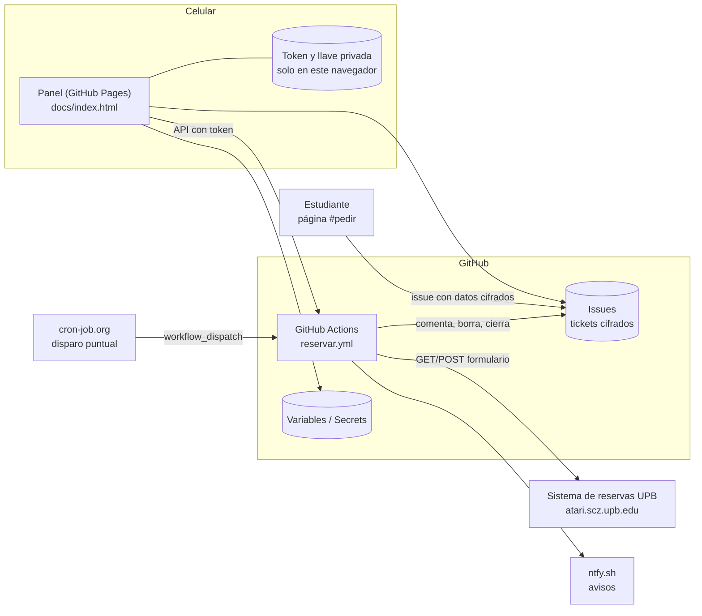
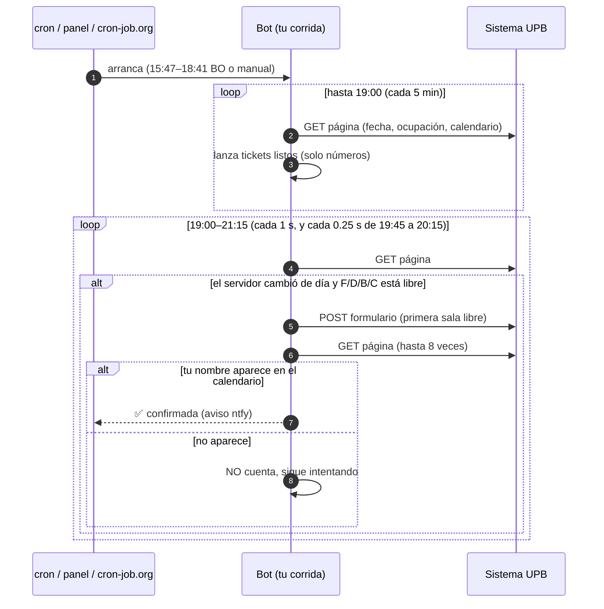
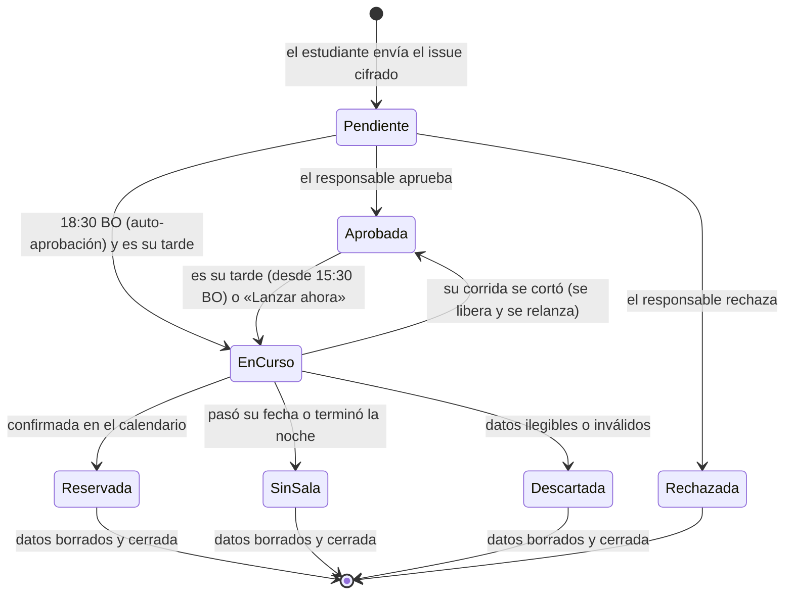

# 03 · Arquitectura y decisiones de diseño

| Campo | Valor |
| :-- | :-- |
| Proyecto | Bot de Reserva de Salas UPB |
| Documento | Arquitectura |
| Versión | 1.1 |
| Fecha | 07/11/2026 |
| Responsable | Hugo Rafael Zúñiga Daza |
| Revisado por | *(pendiente)* |
| Estado | Borrador para revisión |

> Redactado con asistencia de Claude (Anthropic).

## 1. Vista general

Todo corre en servicios gratuitos de GitHub. No hay ningún servidor propio.

| Componente | Archivo | Responsabilidad |
| :-- | :-- | :-- |
| Bot | `reserva_bot.py` | Leer disponibilidad, reservar, verificar, avisar y lanzar tickets |
| Tickets | `solicitudes.py` | Cifrado, validación y operaciones sobre los issues |
| Cifrado web | `docs/cifrado.js` | Mismo formato que el bot (Web Crypto). Lo usan el panel y las pruebas |
| Panel | `docs/index.html` | Página pública (#pedir, #estado) y administración (#inicio, #tickets, #ajustes, #guia) |
| Orquestación | `.github/workflows/reservar.yml` | Horarios, carriles de concurrencia, permisos y liberación de tickets |
| Calidad | `.github/workflows/tests.yml` | pytest + prueba del panel en Chromium |

## 2. Flujo de la reserva del responsable

## 3. Ciclo de vida de un ticket

Cada corrida de ticket usa el carril de concurrencia `upb-ticket-<número>`. Así **corren en paralelo** y no quedan «queued» detrás de la tuya. Tu corrida usa el carril único `reserva-sala-upb`.

## 4. Decisiones de diseño

| ID | Decisión | Alternativas consideradas | Motivo |
| :-- | :-- | :-- | :-- |
| D-01 | Enviar el formulario por HTTP directo | Selenium (v1) | La v1 cerraba el navegador justo después del clic, así que el envío podía no llegar. Además no leía la respuesta. HTTP es más rápido y verificable |
| D-02 | La única fuente de verdad es el calendario del servidor | Confiar en el mensaje «¡Reserva realizada!» | Elimina los falsos positivos (causa raíz de la v1) |
| D-03 | 5 arranques programados, fin por reloj (21:15 BO) y disparo externo opcional | Un solo `cron` a las 18:30 | GitHub retrasó ese `cron` unas 4 h dos días seguidos |
| D-04 | Ritmo fijo en el código, sin flood | «Miles de peticiones cada milisegundo» | El servidor acepta una sola reserva por horario: los duplicados no dan ventaja. Un flood se parece a un ataque de denegación de servicio y arriesga el bloqueo de la IP o la suspensión del workflow |
| D-05 | Tickets como issues cifrados (RSA-OAEP + AES-GCM) | Lista de usuarios en un Secret o Variable; formulario externo | Sin lista no hay estado compartido que se corrompa al borrar a alguien. El repositorio es público, así que solo se guarda texto cifrado |
| D-06 | Una corrida aislada por ticket | Atender a todos en una sola corrida | Pedido explícito. Un error o una eliminación no afecta a nadie más |
| D-07 | Tu corrida solo enruta números de ticket, no descifra | Validar todo en tu corrida | Menos datos en memoria. Cada ticket se valida en su propia corrida |
| D-08 | Tickets con ritmo más suave (1 s) que tu corrida | Mismo ritmo para todos | Limita la carga total sobre el sistema de la UPB |
| D-09 | Panel estático en GitHub Pages. Token y llave solo en el navegador | Backend propio; artifact alojado | Gratis y sin servidor. Un artifact alojado no puede llamar a la API de GitHub |
| D-10 | Estilo UPBnet, logo enlazado desde su URL oficial y aviso «no oficial» | Diseño propio; copiar el logo al repositorio | Pedido del responsable. No se redistribuye la marca. El servidor de la UPB responde 403 a algunos orígenes, por eso hay respaldo de texto |
| D-11 | Liberar el ticket con un paso `if: always()` | Confiar en que el bot siempre termina bien | Si la corrida se cancela o vence, el ticket no queda trabado en «en curso» |
| D-12 | Toda expresión `${{ }}` que lleve `#`, `:` o llaves va entre comillas, y el CI valida con actionlint | Confiar en la revisión visual | En YAML « #» inicia un comentario: el incidente C-10 dejó el workflow inválido sin que ninguna prueba lo notara |
| D-13 | Sala/horario bloqueados y plazos se publican en `docs/servicio.json` (sin nombres). Lo escribe el panel al guardar Ajustes; el bot aplica el mismo bloqueo con su propia configuración | Valores fijos en la página; leer las Variables desde la página pública | La página pública no tiene token para leer Variables. Así el bloqueo sigue a tus ajustes y nunca expone quién es el dueño |
| D-15 | El resultado de cada corrida se publica como un paso «Resultado: <código>» que solo se ejecuta si corresponde, y el panel lo lee de la API de Actions | Anotaciones (piden el permiso Checks); un archivo de estado en el repositorio (un commit por corrida); variables (la corrida no puede escribirlas) | Usa el permiso Actions que el token ya tiene, no crea commits y se ve igual en GitHub y en el panel |
| D-14 | Protección contra copias: licencia con todos los derechos reservados, candado de repositorio (workflow y bot) y candado de dominio (panel) | Hacer privado el repositorio; ofuscar el código | Privado exige pago para Pages y limita los minutos de Actions. Ofuscar dificulta mantener y evaluar el proyecto y no impide copiar. Los candados no son infranqueables (el código es visible), pero vuelven inútil una copia «tal cual» y dejan la intención legal explícita |

## 5. Limitaciones conocidas

- La hora de apertura (20:00 BO) es un supuesto observado (SUP-01). El resumen de cada noche registra la hora real.
- Si los 5 arranques de GitHub y el disparo externo fallan a la vez, el bot no corre. El panel y el aviso 🟢 están para detectarlo a tiempo.
- El historial de ediciones de un issue conserva el texto cifrado anterior al borrado. Sin la llave privada es ilegible, y el responsable puede eliminar esas revisiones desde GitHub.
